<div align="center">

# 📖 Bookmate

**한 권의 실물 책을 친구들과 차례로 돌려 읽는 교환독서 웹 서비스**

픽셀 독서방에 모여 채팅하고, 책에 남긴 흔적을 사진으로 공유하고, 다 읽으면 다음 사람에게 책을 넘겨요.


**[🔗 ssubookmate.duckdns.org 에서 바로 써보기](https://ssubookmate.duckdns.org/)**

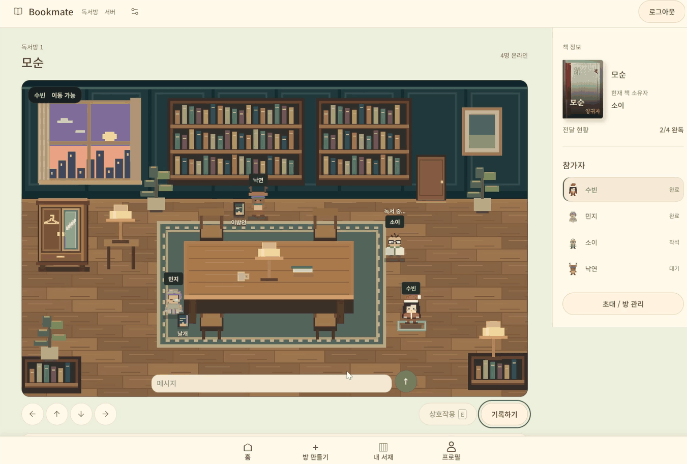

</div>

## 소개

교환독서는 한 권의 책을 여러 사람이 정해진 순서대로 돌려 읽는 독서 방식이에요. 앞사람이 남긴 밑줄과 메모를 다음 사람이 이어서 보는 재미가 있지만, 지금 책이 누구에게 있는지 정리하거나, 책에 남긴 생각을 함께 나누거나, 다 읽은 뒤 감상을 모아 두기는 쉽지 않아요.

**Bookmate**는 이 과정을 하나의 웹 서비스로 묶었어요.

- 📚 **방 만들기와 초대**: 함께 읽을 책과 표지를 정하고, 초대 링크·코드로 친구를 불러요. 공개방으로 열어 두면 코드 없이도 들어올 수 있어요.
- 🔁 **읽는 순서와 책 전달**: 지금 누가 책을 가지고 있는지 보이고, 다 읽으면 감상평을 남기고 다음 사람에게 넘겨요. 늦게 온 친구는 마지막 순서로 합류해요.
- 🏠 **픽셀 독서방**: 같은 방 친구들이 캐릭터로 모여 실시간으로 움직이고, 의자에 앉고, 채팅해요.
- 📸 **페이지 기록**: 책에 남긴 페이지를 사진으로 올리고, 사진 위에 그림을 그리거나 댓글을 달아요. 아직 차례가 안 온 사람에게는 보이지 않아요.
- 🎫 **완독 기록**: 모두 다 읽으면 감상평 히스토리와 기념 티켓이 만들어지고, 책이 내 서재에 꽂혀요.

## 화면 둘러보기

> 아래 화면은 팀원 네 명이 배포 서버에서 실제로 교환독서 한 바퀴를 진행하며 찍은 캡처예요.

### 1. 홈 · 방 만들기

| 나의 교환독서 | 방 만들기 |
| :---: | :---: |
| 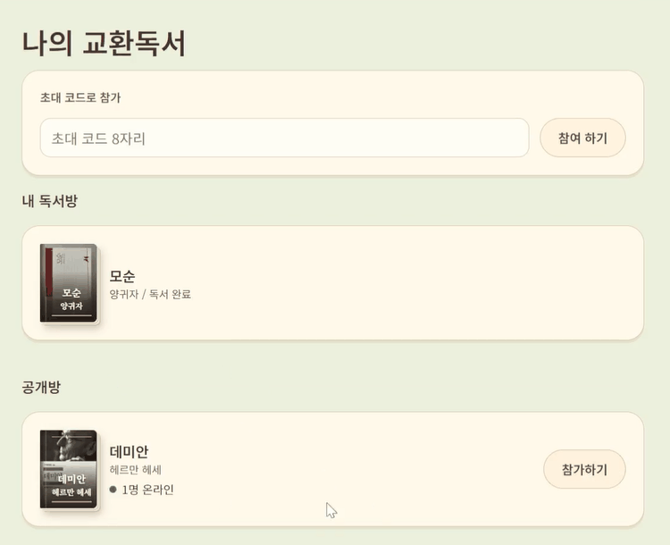 | 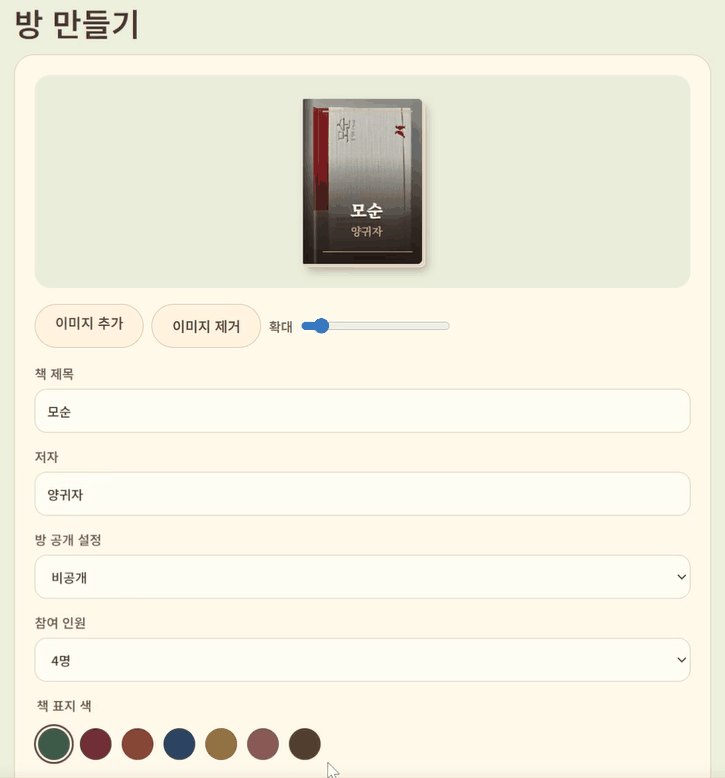 |
| 내 독서방과 지금 참가할 수 있는 공개방이 보여요. 초록 점은 접속 중인 인원이에요. 공개방은 **참가하기**로 바로 들어가고, 비공개 방은 초대 코드로 참가해요. 내 독서방 카드를 길게 누르면 목록에서 지울 수 있어요. | 책 제목·저자·인원(2~10명)을 정하고 표지 색을 고르거나 사진을 올려요. 사진은 미리보기에서 드래그하고 확대해 위치를 맞추면 제목과 저자가 그 위에 얹혀요. |

### 2. 캐릭터 꾸미기

<p align="center">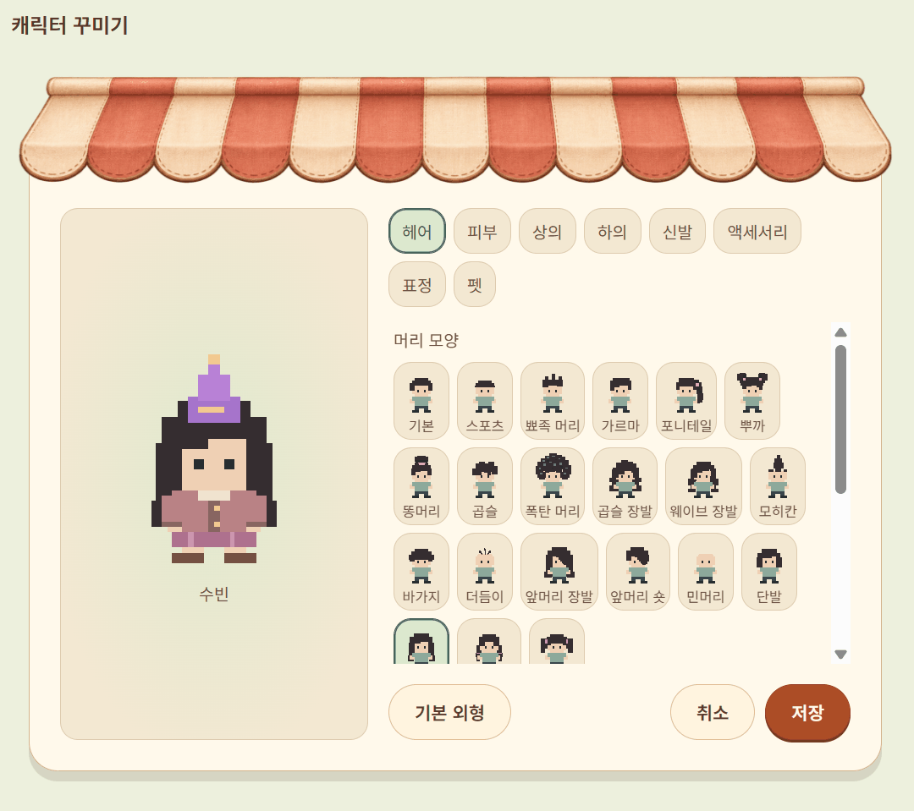</p>

헤어·피부·상의·하의·신발·액세서리·표정·펫을 골라요. **프로필에서 꾸민 모습은 모든 방의 기본 외형**이 되고, 독서방 안의 옷장에서 바꾼 모습은 그 방에서만 적용돼요.

### 3. 픽셀 독서방

| 함께 읽기 | 참가자 프로필 |
| :---: | :---: |
| 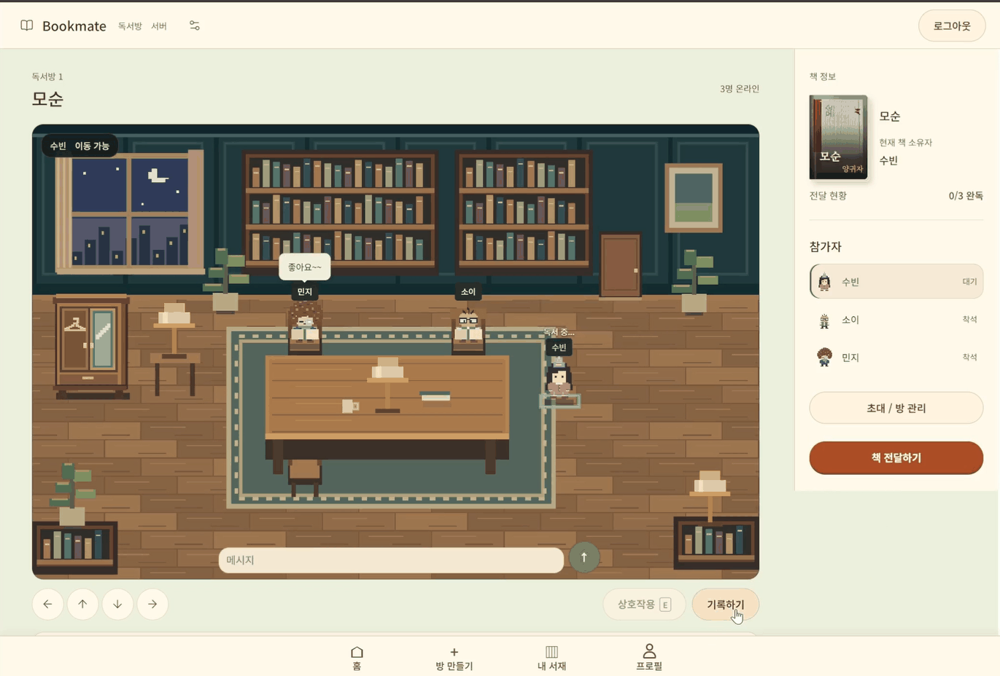 | 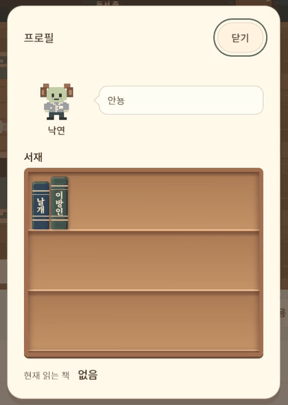 |
| 방을 만들면 바로 입장하고, 초대받은 친구는 문을 열고 걸어 들어와요. 방향키나 클릭으로 움직이고, 의자 근처에서 **E**를 누르면 앉아요. 채팅은 머리 위 말풍선으로도 보이고, 오른쪽에서 현재 책 소유자와 참가자 상태를 확인해요. | 다른 참가자에게 다가가 **E**를 누르면 그 사람의 상태 메시지와 서재(완독한 책)를 볼 수 있어요. |

### 4. 페이지 기록

| 기록 올리기 | 댓글과 그림 |
| :---: | :---: |
| 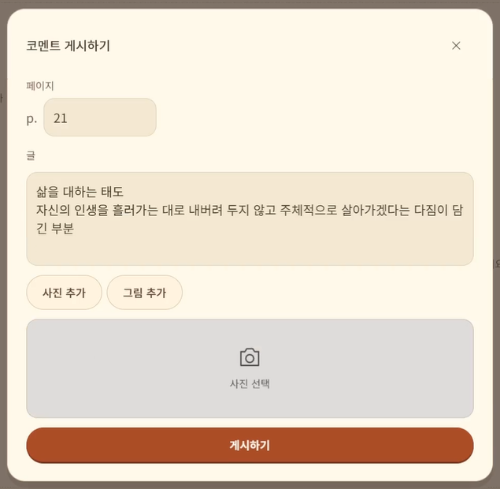 | 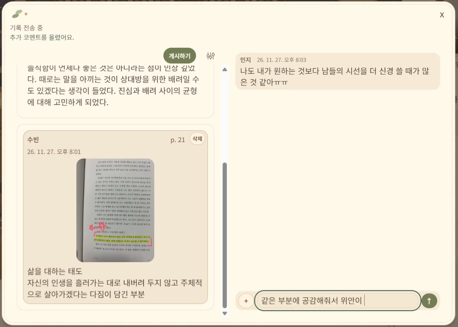 |
| 페이지 번호와 생각을 적고, 밑줄 친 페이지 사진을 붙여요. | 앞사람의 기록에 댓글을 달고, 사진 위에 직접 표시를 그려요. 기록은 지금 읽는 사람과 이미 다 읽은 사람만 볼 수 있어서 스포일러가 없어요. |

### 5. 책 전달 · 완독

| 감상평 남기고 전달 | 모두 완독 |
| :---: | :---: |
| 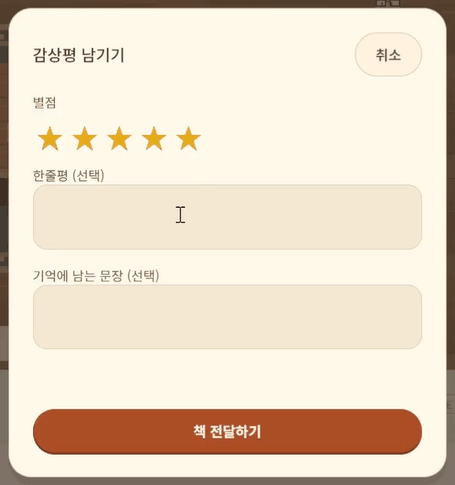 | 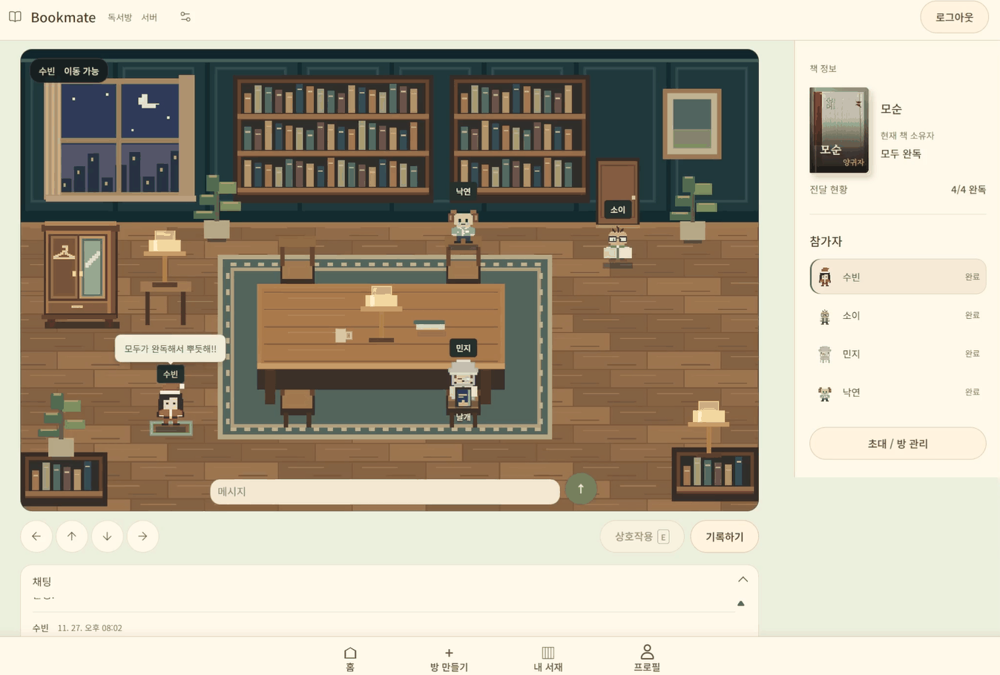 |
| 다 읽으면 별점·한줄평·기억에 남는 문장을 남기고 다음 사람에게 책을 넘겨요. | 마지막 사람까지 읽으면 교환독서가 완료되고, 책 표지 펫을 얻어요. |

### 6. 히스토리 · 내 서재

| 히스토리와 완료 티켓 | 내 서재 |
| :---: | :---: |
| 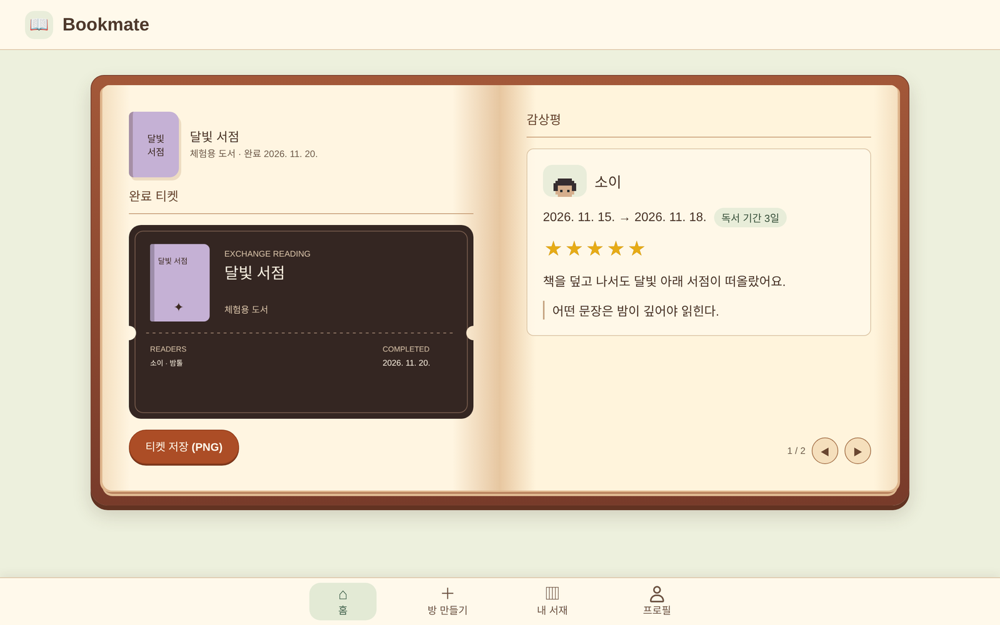 | 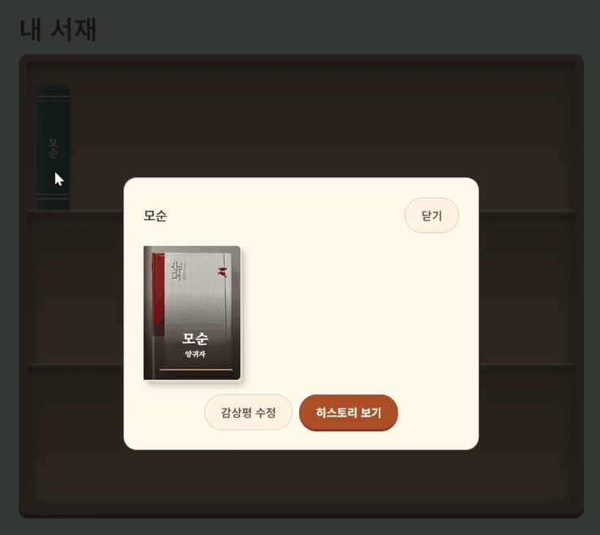<br> |
| 참가자별 감상평을 넘겨 보고, 함께 읽은 사람과 완료 날짜가 적힌 티켓을 PNG로 저장해요. | 완독한 책이 책장에 꽂혀요. 책을 누르면 감상평을 고치거나 히스토리로 이동해요. |

### 7. 방 나가기

<p align="center">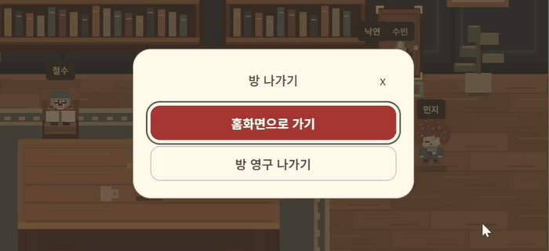</p>

문으로 나가면 **홈화면으로 가기**(잠시 나가기)와 **방 영구 나가기**를 고를 수 있어요. 영구히 나가도 그동안 남긴 기록과 순서는 방에 남고, 마지막 참가자가 나가면 방과 채팅·기록을 함께 삭제할지 물어봐요.

## 바로 실행해 보기

### 방법 1. 배포 서버에서 써보기

설치 없이 **https://ssubookmate.duckdns.org/** 에 접속해 회원가입하면 돼요. 친구와 각자 기기에서 접속해 같은 방에 들어가 보세요.

### 방법 2. 화면만 빠르게 보기 (Node.js만 필요)

DB나 설치 과정 없이 체험 모드로 실행돼요. 데이터는 브라우저와 로컬 JSON 파일에만 저장돼요.

```bash
git clone https://github.com/pineapple3544/Bookmate.git
cd Bookmate
node apps/room-prototype/server.js
```

브라우저에서 **http://localhost:5173** 을 열면 돼요. Node.js **24**가 필요해요. 대기 중인 체험방은 [대기 화면](http://localhost:5173/?screen=demo&state=waiting)에서 열 수 있어요.

### 방법 3. 회원가입·DB까지 직접 실행 (Docker 필요)

[Docker Desktop](https://www.docker.com/products/docker-desktop)을 실행한 상태에서:

```bash
cp .env.example .env        # Windows PowerShell: copy .env.example .env
docker compose up --build
```

**http://localhost:5173** 에서 회원가입 후 로그인하면 돼요. 일반 창과 시크릿 창에서 다른 계정으로 접속하면 채팅과 캐릭터 이동이 실시간으로 맞춰지는 걸 볼 수 있어요. 끌 때는 `Ctrl + C` 후 `docker compose down`을 실행해요. 가입한 계정 같은 데이터는 그대로 남아요.

> 개발 서버 실행, 테스트, 배포 관련 내용은 [개발 가이드](docs/development.md)에 정리돼 있어요.

## 기술 스택

| 구분 | 사용 기술 |
| --- | --- |
| 프론트엔드 | HTML · CSS · Vanilla JavaScript (ES Modules), Canvas 픽셀 렌더링, IndexedDB |
| 백엔드 | Node.js 24 · TypeScript · Fastify 5 (CORS, Rate Limit, Swagger/OpenAPI, WebSocket) |
| 데이터베이스 | PostgreSQL 17 · Prisma 7 |
| 실시간 | WebSocket (접속 상태·캐릭터 이동 중계·WebRTC 시그널링), WebRTC DataChannel (캐릭터 이동·페이지 기록 P2P 공유) |
| 인프라 | Docker · Docker Compose, GitHub Actions (타입 검사·테스트·브라우저 테스트) |
| 테스트 | Node.js test runner, Playwright 브라우저 테스트 |

## 구조

```text
Bookmate/
├── apps/
│   ├── room-prototype/      # 웹 화면 (홈, 방 만들기, 픽셀 독서방, 서재) + 정적 서버
│   │   ├── public/          #   화면 HTML·CSS·JS
│   │   ├── server.js        #   정적 파일 제공, 체험 모드 API, /api 프록시
│   │   └── test/            #   브라우저·단위 테스트
│   └── server/              # Fastify API 서버 (인증, 방, 공개방, 책 전달, 채팅, 실시간)
│       ├── src/
│       └── test/
├── packages/
│   ├── contracts/           # 서버·클라이언트 공통 응답 타입
│   └── api-client/          # 브라우저에서 쓰는 API 클라이언트
├── prisma/                  # DB 스키마와 마이그레이션
├── docs/                    # 개발 가이드, API 문서, 화면 캡처
├── compose.yaml             # 웹 + API + DB 전체 실행
└── compose.local.yaml       # 웹만 실행 (체험 모드)
```

## 주요 설계

**인증과 보안**
- 비밀번호는 scrypt와 사용자별 salt로 해시하고, 세션은 HttpOnly · SameSite=Strict 쿠키로만 주고받아요. 토큰을 JavaScript나 localStorage에 두지 않아요.
- 변경 요청은 허용된 Origin만 받아서 CSRF를 막고, 가입·로그인에는 별도의 요청 횟수 제한을 걸었어요.
- 세션·초대 토큰은 원문 대신 SHA-256 해시만 DB에 저장해요.
- 표지 사진은 업로드 파일을 그대로 저장하지 않아요. 정해진 크기의 픽셀 데이터만 받아서 서버가 PNG를 새로 만들어 저장해요.

**책 전달의 일관성**
- 책 소유자 변경, 읽기 시작, 전달 이력 기록은 하나의 트랜잭션으로 처리해요.
- 방마다 `version`을 두어, 두 사람이 동시에 전달을 시도하면 한쪽은 409로 거절돼요.
- 전달·채팅 요청에 UUID 재시도 키를 붙여서, 네트워크가 끊겨 다시 보내도 중복으로 기록되지 않아요.
- 참가자가 방을 영구히 나가면 이름과 읽는 순서를 따로 남겨서, 그 사람의 기록과 히스토리가 사라지지 않아요.

**실시간과 기록 공유**
- 서버가 WebSocket으로 누가 어느 방에 접속해 있는지 관리해서, 홈의 접속 인원과 지금 누군가 들어와 있는 공개방 목록을 보여줘요.
- 캐릭터 이동은 참가자 브라우저끼리 직접 연결(WebRTC)을 먼저 쓰고, 직접 연결이 안 되는 상대에게는 서버가 중계해요.
- 페이지 사진·댓글·그림은 서버에 올리지 않고 WebRTC DataChannel로 참가자 브라우저끼리 직접 주고받아요. 서버는 누가 볼 수 있는지와 기록 목록 같은 메타데이터만 관리해요.

**DB 모델**: `User` · `Session` · `Room` · `RoomMember` · `RoomInvite` · `RoomCover` · `RoomDeparture` · `BookTransfer` · `ChatMessage` · `RecordOperation`

API 전체 목록과 사용법은 [서버 API 가이드](docs/server-api.md), P2P 기록 공유 구조는 [P2P 기록 공유](docs/p2p-records.md)를 참고하세요.

## 문서

| 문서 | 내용 |
| --- | --- |
| [개발 가이드](docs/development.md) | 개발 환경, 서버·DB 실행, 검증 명령, 배포 메모 |
| [서버 API 가이드](docs/server-api.md) | 인증 규칙, HTTP API, WebSocket·WebRTC 시그널링 |
| [통합 가이드](docs/integration-20261115.md) | 화면과 서버 연동 방식, 검증 기록 |
| [P2P 기록 공유](docs/p2p-records.md) | 페이지 기록 공유 구조와 TURN 설정 |
| [시제품 README](apps/room-prototype/README.md) | 픽셀 독서방 기능, 체험·서버 모드 차이 |

## 라이선스

[MIT License](LICENSE)

---

<sub>숭실대학교 웹프로그래밍 수업 팀 프로젝트</sub>
